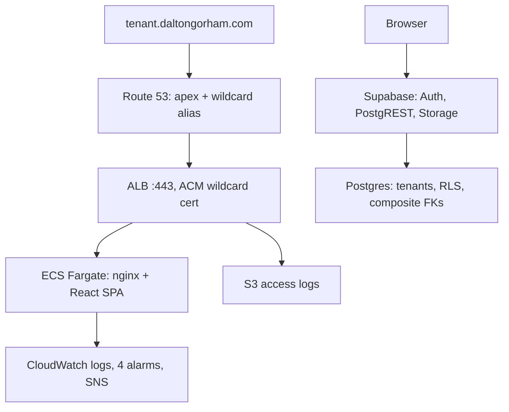

# GeneHub AWS Migration Plan

Status: in progress — development environment live, production not yet migrated
Last updated: 2026-07-29
Supersedes: the original plan of 2026-07-27, which proposed replacing Supabase
with RDS, Cognito, and a FastAPI backend. That path was assessed and dropped.
See §9.

## 1. What changed, and why

The original plan had two halves: move hosting to AWS, then replace Supabase
with RDS + Cognito + FastAPI + S3.

**The first half was done. The second was abandoned deliberately.**

Nothing in GeneHub required leaving Supabase. The usual forcing functions —
compliance, data residency, scale, or server-side logic that cannot live in
Postgres — none applied to fourteen tables and a job that emails people about
low nitrogen. What it would have cost was the entire backend rewrite: a Cognito
migration with forced password resets for every user, porting eleven functions
and twenty-three policies, moving storage to S3, rewriting three edge functions
as Fargate workers, and converting nine frontend API modules from Supabase
clients to HTTP clients.

Critically, **multi-tenancy never required it**. `tenant_id` on every table,
tenant-aware constraints, composite foreign keys, and RLS comparing row tenant
to session tenant are ordinary Postgres. Supabase is Postgres. That work is
identical either way, and it is the hard part.

The accepted trade-off: the browser talks to the database directly, so **all
authorisation lives in RLS**. There is no server-side second layer. That is why
the policies in §4 are covered by an automated isolation suite rather than
reviewed by eye.

## 2. Current architecture



AWS serves the application bundle. The browser talks to Supabase directly for
everything else. AWS holds no application data.

### Hosting

| Component | Detail |
|---|---|
| Account / region | `257289932696`, `us-east-1` |
| VPC | `10.0.0.0/16`, 2 AZs, three `/20` tiers per AZ: public, private-app, isolated data |
| Egress | One NAT gateway (dev). `single_nat_gateway = false` gives one per AZ |
| Endpoints | S3 gateway; interface endpoints for `ecr.api`, `ecr.dkr`, `logs`, `secretsmanager`, `sts` |
| Load balancer | Public ALB; 80 redirects to 443; `preserve_host_header`, `desync_mitigation_mode = strictest` |
| Compute | ECS Fargate, 1 task, 256 CPU / 512 MiB, private subnets, no public IP |
| Registry | ECR, immutable tags, scan on push, lifecycle expiry |
| DNS / TLS | Route 53 zone for `daltongorham.com`; ACM cert covering apex **and** `*.daltongorham.com` |
| Observability | VPC flow logs, ALB access logs to S3, four alarms to SNS |

The isolated data tier has **no default route** and is currently unused. It
exists because it is far cheaper to create now than to move a database into
later, should RDS ever become necessary.

Roughly $50/month: NAT ~$32, ALB ~$16, interface endpoints, minimal logs.

### Domain

`daltongorham.com` is a **stand-in**. Production still serves from Vercel on the
real domain. Swapping is one line in `dev.tfvars` plus a nameserver delegation.

The wildcard certificate and wildcard alias record are what make tenancy work:
**onboarding a tenant requires no infrastructure change at all.**

## 3. Application model

### Apex is a landing page; workspaces live on subdomains

- `daltongorham.com` — create a workspace. No login.
- `<slug>.daltongorham.com` — login and the application, branded per tenant.

Signing in at the apex was removed because it produced an incoherent page:
generic branding wrapped around a specific tenant's data, since no tenant can be
resolved from the hostname.

Signup ordering matters and is not accidental. `create_tenant_with_owner()`
creates the tenant and an `allowed_emails` invitation but **not** the account.
The client then redirects to `<slug>.<domain>/signup?email=…`, where the
existing `handle_new_user()` trigger consumes the invitation. Creating the
account at the apex would strand the session there — Supabase stores it in
`localStorage`, which is scoped per origin.

### Cross-workspace access

A valid account signing in at a workspace it does not belong to is **signed out
and told so**. Redirecting was tried and removed: the session cannot cross
origins, so it only produced a second login with no explanation.

This is presentation, not security. RLS already guarantees a user reads only
their own tenant's rows regardless of hostname.

### Tenant model

**One tenant per user, no roles.** `employees.tenant_id` is the single source of
truth; membership alone grants access. A join table and a role column were
considered and rejected as unneeded complexity.

Consequence: the tenant comes from the JWT, not the hostname. The subdomain is
branding and routing, never an authorisation boundary.

### Branding

Per-tenant name, legal name, logo, login hint, and report footer live on the
`tenants` row. `src/config/tenant.ts` is a mutable module object hydrated at
startup: from the signed-in user's tenant, or — before login — from the
subdomain via the anon-callable `get_tenant_branding()` RPC. About twenty
components read it directly; a React context would have been churn for a value
that changes at most twice per session.

## 4. Database migrations

Production is still on `000` alone. Everything below is applied to dev only.

| Migration | Purpose |
|---|---|
| `000_schema.sql` | Baseline. Verified faithful to production |
| `001_generic_owner_type` | `owner_type` value `'rck'` → `'internal'` |
| `002_tenants` | `tenants` table, `tenant_id` on all 14 tables, backfill, tenant-aware uniques, `current_tenant_id()`, `security_invoker` on two leaky views |
| `003_tenant_rls` | Replaces all 23 policies with tenant-scoped ones; enables RLS on `tenants` |
| `004_tenant_id_default` | `tenant_id` defaults to `current_tenant_id()` so the client never sends it |
| `005_composite_fks` | 15 foreign keys rewritten to include `tenant_id` |
| `006_tenant_branding` | Branding columns + `get_tenant_branding()` |
| `007_tenant_signup` | `reserved_slugs`, `is_slug_available()`, `create_tenant_with_owner()` |

`supabase db diff --linked` reproduces dev exactly; the only differences are
Supabase platform artifacts (`pg_net`, an `rls_auto_enable` event trigger).

**Two things to resolve before promoting to production:**

- `002` and `006` insert and backfill an `rck` tenant. Correct for promoting
  RCK's production; wrong for a fresh environment for anyone else.
- No migration creates `pg_net`, which production's `pg_cron` notification jobs
  depend on.

### Isolation is enforced at two independent layers

**RLS** governs access. Every policy compares `tenant_id` against
`current_tenant_id()`, which reads the caller's `employees` row and is
`SECURITY DEFINER` — without that, the policy on `employees` would recurse into
itself.

**Composite foreign keys** govern integrity. `genetic_inventory(tenant_id,
sire_id) → sires(tenant_id, id)` makes a cross-tenant reference structurally
impossible, independent of who is asking. Ten are `ON DELETE SET NULL` and use
Postgres 15+'s column-list syntax, since nulling the whole key would violate
`tenant_id NOT NULL`.

One consequence worth remembering: PostgREST resolves embedded selects from
foreign-key metadata, so hints must name the **constraint**, not the column —
`employees!activity_log_user_id_fkey`, not `employees!user_id`.

### Verification

`frontend/supabase/tests/` — run in the SQL editor, both roll back.

- `tenant_isolation.sql` — 13 checks. Impersonates a real user via
  `request.jwt.claims`, since the SQL editor connects as owner and bypasses
  every policy. Covers scoped reads, all three views, insert defaulting, and
  cross-tenant insert/update/delete. Expected counts are measured at run time,
  not hardcoded, so working in the app does not cause false failures.
- `composite_fks.sql` — 8 checks. Runs as owner deliberately: the claim is that
  the database refuses cross-tenant references even for a caller every policy
  would allow.

Both suites pass in full.

## 5. Operations

```bash
./scripts/put-supabase-secrets.sh dev     # store Supabase URL + anon key
./scripts/build-and-push.sh dev [tag]     # build, push to ECR (defaults to git sha)
# set image_tag in infra/terraform/dev.tfvars
./scripts/deploy-infra.sh apply           # plan/apply; creates state backend if absent
./scripts/destroy-infra.sh destroy        # teardown; never removes state or lock table
```

Terraform never builds images and never runs DDL. State lives in S3
(`genehub-infra`) with DynamoDB locking (`terraform-locks`), created on demand
by `deploy-infra.sh`.

`build-and-push.sh` forces `--platform linux/amd64` (Apple Silicon would
otherwise produce an arm64 image that dies with `exec format error` on Fargate)
and `--provenance=false --sbom=false` (ECR rejects BuildKit's attestation
manifests with a bare 400).

### Environments

| | Hosting | Supabase | Domain |
|---|---|---|---|
| Production | Vercel | `xnusvnwzvinhopkwmljl` | real domain |
| Development | AWS ECS | `tveluoilwhbfpyqxqnzf` | `daltongorham.com` |

Separate Supabase projects are what make schema work safe. Before that split,
dev and production shared one database and any migration would have been applied
to live customer data.

## 6. Remaining work

### Before production cutover

1. **Apply `001`–`007` to production**, having resolved the `rck`-specific data
   in `002`/`006` and the missing `pg_net`.
2. **Notifications are untouched.** Production still runs `pg_cron` + `pg_net` +
   Resend and three edge functions. None are tenant-aware — they will email
   across tenant boundaries once production is multi-tenant.
3. **Storage is untouched.** Sire images sit in a public `sire-images` bucket
   with no tenant prefix and no per-tenant access control. Currently the largest
   hole in the isolation story.
4. **Point the real domain at AWS** and retire Vercel.

### Quality

- `TODO.md` — landing page redesign, and verification of the shell caching fix
- 47 tests fail on `localStorage.clear is not a function`, a jsdom/vitest
  environment issue predating this work. User-settings behaviour has no coverage.
- Main bundle is 748 kB (194 kB gzipped); no route-level code splitting
- `npm audit` reports 16 vulnerabilities, 2 critical
- Self-serve signup is anonymous and unthrottled. Needs email verification, a
  CAPTCHA, or a signup code before it is genuinely public.

### Deferred by choice

- **Offline support.** The service worker caches nothing; it exists only for
  installability. Real offline means persisting React Query to IndexedDB and
  designing for offline writes.
- **RDS.** The isolated data tier and its security group are already in place.
- **Roles.** Flat membership today. Adding roles later means a column and a
  policy revision, not a redesign.

## 7. What each layer actually protects

Worth stating plainly, because these are easy to confuse:

- **Hostname** — branding and routing. Not a boundary. An RCK user at Bar 7's
  subdomain sees Bar 7's logo and their own data.
- **JWT + `current_tenant_id()`** — the real boundary. Determines every row the
  user can reach.
- **RLS** — enforces it on every table and view.
- **Composite FKs** — prevent cross-tenant references even from callers RLS
  would allow, such as the service role.
- **Frontend checks** — remove confusing states. They stop nothing.

## 8. Decisions recorded

| Decision | Outcome |
|---|---|
| Replace Supabase with RDS/Cognito/FastAPI | **No.** No requirement justified the cost |
| Tenancy by subdomain or URL path | **Subdomain.** Origin isolation, and the PWA works unchanged |
| Users in multiple tenants | **No.** One tenant per user |
| Roles within a tenant | **None.** Membership grants access |
| `owner_type` value | Renamed `'rck'` → `'internal'`; label comes from tenant name |
| Repo of record | This one. Frontend copied in without history |
| Region / domain | `us-east-1`; `daltongorham.com` as a stand-in |

## 9. The abandoned path, and what would revive it

The original plan's Phases 2 and 3 — RDS PostgreSQL, Cognito user pools, a
Python/FastAPI backend, S3 storage, EventBridge workers — are not being built.

What would justify revisiting:

- A customer contract requiring data isolation or a specific region
- Postgres extensions Supabase does not permit
- Connection or performance limits that cannot be resolved within Supabase
- Wanting a server-side authorisation layer rather than relying solely on RLS
- Cost consolidation, once ECS and NAT are being paid for regardless

The schema work already done transfers directly: `tenant_id`, tenant-aware
constraints, and composite foreign keys are ordinary Postgres and would move to
RDS unchanged. What would still need building is the API, the auth migration,
and the storage move.
