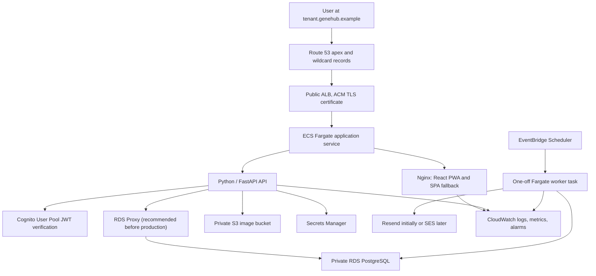

# GeneHub AWS Migration Plan

Status: proposed  
Prepared: 2026-07-27  
Source reviewed: `/Users/daltongorham/Git/GeneHub`

## 1. Executive decision

Migrate GeneHub in two major steps:

1. **Hosting migration:** containerize the existing React/Vite PWA and run it on ECS Fargate behind an Application Load Balancer while it continues to use Supabase.
2. **Platform migration:** add a Python/FastAPI backend API on ECS, move PostgreSQL to RDS, auth to Amazon Cognito, object storage to S3, and scheduled notification work to EventBridge Scheduler plus Fargate workers.

This gets an AWS-hosted application working early and separates the low-risk hosting move from the larger Supabase replacement.

### Recommended architecture decisions

- Use **Amazon Cognito User Pools** for authentication.
- Use **Python with FastAPI** for the application API and scheduled worker code.
- Do **not** use API Gateway in the first version. API Gateway is an API front door and JWT authorizer, not an identity provider. The existing ALB can route both the web application and `/api/*` traffic.
- Use **one shared ECS service** for the multi-tenant application unless dedicated compute is a contractual isolation requirement.
- Resolve tenants from the subdomain, but always verify the authenticated user's tenant membership in the backend.
- Use **one shared RDS PostgreSQL database** with `tenant_id` on all tenant-owned rows and PostgreSQL RLS as defense in depth.
- Use a wildcard Route 53 record and wildcard ACM certificate, so adding a logical tenant does not require Terraform or DNS changes.
- Keep schema migrations outside Terraform. Run them as a controlled one-off ECS task during deployment.

## 2. Current application findings

GeneHub is currently:

- A React 19/Vite SPA and PWA hosted on Vercel.
- A browser-to-Supabase application with no server-side application backend.
- Directly coupled to Supabase Auth, PostgREST table queries, PostgreSQL RPC functions, and Supabase Storage.
- Using a PostgreSQL schema with 14 tables, 3 views, 11 functions, and 23 RLS policies.
- Using three Supabase Edge Functions for low-stock, low-nitrogen, and periodic reminder emails.
- Using `pg_cron`, `pg_net`, and Resend for scheduled notifications.
- Using an `allowed_emails` invitation model and a trigger on `auth.users`.
- Storing sire images in the public `sire-images` Supabase Storage bucket.
- Importing Vercel Analytics and Speed Insights in the frontend.

The code does not currently use Supabase realtime channels, despite realtime being mentioned in the architecture document. No realtime replacement is needed for the initial migration.

### Important gaps

- The database is single-tenant today; none of the business tables has `tenant_id`.
- Existing RLS policies generally authorize every authenticated user, rather than isolating organizations.
- RDS cannot be called safely from a browser. A backend API is required.
- Supabase Auth's `auth.users` schema, auth helper functions, and database triggers are not portable to RDS as written.
- Supabase Storage APIs and public URLs must be replaced with S3 object keys and upload/download flows.
- Supabase user passwords should be treated as non-portable. Plan on Cognito invitations or password resets unless a just-in-time migration is deliberately built.

## 3. Target architecture



### Network layout

- One VPC spanning at least two Availability Zones.
- Public subnets: ALB and NAT gateways.
- Private application subnets: ECS tasks.
- Isolated/private data subnets: RDS and RDS Proxy.
- Security group flow:
  - Internet to ALB on 443 only.
  - ALB to ECS application port only.
  - ECS to RDS Proxy/PostgreSQL only.
  - No public RDS endpoint.
- For a low-cost nonproduction environment, use one NAT gateway. Production should use a NAT gateway per AZ or the required VPC endpoints plus an explicit egress design.

### Request routing

- `genehub.example` can serve a landing page or redirect.
- `*.genehub.example` points to the same ALB.
- `/api/*` is handled by the backend.
- All other paths are handled by Nginx with `try_files ... /index.html` for SPA routing.
- The backend obtains the tenant slug from a validated `Host` header, looks up the tenant, and checks membership for the JWT `sub`.
- A tenant supplied in a request body, query string, or custom client header is never authoritative.

## 4. Authentication and authorization

### Why Cognito, not API Gateway

Cognito User Pools replace Supabase Auth by managing users, password policies, reset flows, MFA, and JWT issuance. API Gateway can validate Cognito JWTs, but it does not manage the users. Because the platform already needs an ALB for ECS and browser traffic, adding API Gateway now would create a second public routing layer without solving a current requirement.

Reconsider API Gateway later if GeneHub needs:

- A public or partner API with usage plans and API keys.
- Per-route quotas or monetization.
- Many Lambda-backed endpoints.
- WebSocket APIs.
- A centralized API front door for several independently operated backend systems.

### Initial Cognito design

- One user pool per environment, not one user pool per tenant.
- One public SPA app client with no client secret.
- Keep tenant roles in PostgreSQL `tenant_memberships`, not in Cognito groups.
- Use the Cognito `sub` only as the external identity key.
- Disable open self-registration initially; use tenant-admin invitations.
- Adapt the existing login, sign-up, forgot-password, and reset-password screens to Cognito's flows.
- The API validates JWT signature, issuer, app client/audience, expiry, and token use.
- The API loads current membership from PostgreSQL on each request or from a short-lived server-side cache.
- Tenant suspension is checked in the database and takes effect without waiting for a JWT to expire.

For the first implementation, the SPA may obtain Cognito tokens with the supported Cognito client library and send the access token as a bearer token. Before production, make an explicit security decision between this approach and a backend-for-frontend session using secure, HTTP-only cookies.

### User migration

Recommended default:

1. Export user identity metadata from Supabase.
2. Create matching `app_users` records in RDS.
3. Create or invite the users in Cognito.
4. Require a Cognito password setup/reset.
5. Store the Cognito `sub` on the matching `app_users` record after account activation.

A just-in-time Cognito user migration Lambda is possible, but it would keep Supabase Auth available during transition and adds security and operational complexity. Use it only if forced password resets are unacceptable.

## 5. Database and tenant model

### Core identity tables

Add:

- `tenants(id, slug, name, status, settings, created_at, updated_at)`
- `app_users(id, cognito_sub, email, full_name, status, created_at, updated_at)`
- `tenant_memberships(tenant_id, user_id, role, status, invited_by, accepted_at, created_at)`

Use an internal UUID for `app_users.id`; keep `cognito_sub` as a unique external identifier.

### Tenant-owned data

Add a non-null `tenant_id` to every tenant-owned table:

- `employees`
- `customers`
- `sires`
- `tanks`
- `canisters`
- `genetic_inventory`
- `supply_categories`
- `supply_inventory`
- `supply_usage_log`
- `nitrogen_fill_history`
- `user_settings`
- `notification_log`
- `activity_log`
- `allowed_emails`

`user_settings` should be scoped by both user and tenant so that a person belonging to two organizations can have different preferences in each.

### Constraints that must change

- Include `tenant_id` in business uniqueness rules, such as tank names, category names, allowed email invitations, and canister positions/numbers.
- Prevent cross-tenant references with composite foreign keys such as `(tenant_id, customer_id) -> customers(tenant_id, id)`.
- Add tenant-leading indexes for common list, search, and notification queries.
- Update all views and stored functions to return and filter the current tenant.
- Make tenant backfill and `NOT NULL` enforcement separate migration steps for a live-data migration.

### RLS model on RDS

Do not copy Supabase's `auth.uid()` and `auth.role()` policies.

For every API transaction:

1. Begin a database transaction.
2. Set transaction-local values for `app.user_id` and `app.tenant_id`.
3. Execute the query.
4. Commit or roll back.

RLS policies compare each row's `tenant_id` with `current_setting('app.tenant_id', true)`. Use a runtime database role that does not own the tables and does not have `BYPASSRLS`. Keep the migration/owner role separate from the runtime role.

The API must still include explicit tenant filters. RLS is the second boundary, not a substitute for clear application queries.

### Supabase-specific schema changes

- Replace foreign keys to `auth.users` with foreign keys to `app_users`.
- Remove the trigger on `auth.users`.
- Replace `auth.uid()`, `auth.role()`, and Supabase JWT helpers.
- Remove `pg_net`; scheduled work will not call HTTP from the database.
- `pg_cron` is available on supported RDS PostgreSQL versions, but prefer EventBridge Scheduler so schedules, retries, and failures are visible in AWS.
- Preserve portable views and business functions where they remain useful.

## 6. Backend API

Build a Python/FastAPI API in the existing monorepo:

- FastAPI served by an ASGI server such as Uvicorn.
- Pydantic request, response, and configuration models.
- SQLAlchemy 2 with the Psycopg PostgreSQL driver, explicit transactions, and connection pooling.
- Alembic for ordered, repeatable database schema migrations.
- A Cognito JWT-validation dependency shared by protected routes.
- Structured JSON logging with request and tenant correlation IDs.
- `/healthz` for process health and `/readyz` for dependency readiness.
- Pytest for unit and API integration tests.
- OpenAPI generated by FastAPI as internal API documentation.
- API modules matching the current frontend modules:
  - auth/profile
  - tenants/memberships/invitations
  - customers
  - sires
  - tanks/canisters/fill history
  - genetic inventory
  - medical inventory/categories/usage
  - activity
  - settings
  - reports
  - image upload/delete

The frontend's nine Supabase-coupled API modules become ordinary HTTP clients. Existing React Query hooks and UI components should remain largely unchanged. TypeScript API response types can initially be maintained in the frontend and later generated from FastAPI's OpenAPI document if that proves useful.

### File storage

- Use a private, encrypted S3 bucket with public access blocked.
- Store object keys in PostgreSQL instead of permanent Supabase public URLs.
- Prefix every object with the tenant ID, for example `tenants/{tenantId}/sires/{sireId}/...`.
- Have the API issue short-lived presigned upload and download URLs after checking membership.
- Add content type, file size, and allowed-extension validation.
- Add CloudFront only if image delivery or caching needs justify it.

### Notifications

- Reuse the FastAPI application image with Python worker entry points:
  - `notify-low-nitrogen`
  - `notify-low-stock`
  - `notify-periodic-reminder`
- EventBridge Scheduler starts an ECS Fargate task for each schedule.
- Configure retry limits and a dead-letter queue.
- Retain Resend for the first migration by storing its key in Secrets Manager.
- Consider SES as a separate follow-up, not as part of the critical path.
- Make notification jobs idempotent because schedules can be delivered more than once.

## 7. Terraform organization

Suggested layout:

```text
infra/
  bootstrap/
  modules/
    network/
    security/
    ecr/
    database/
    cognito/
    load-balancer/
    ecs-application/
    object-storage/
    scheduler/
    observability/
    dns/
  environments/
    dev/
    staging/
    production/
```

### Terraform-managed resources

- VPC, subnets, routing, NAT, and VPC endpoints.
- Security groups and IAM roles/policies.
- ECR repositories with image scanning and lifecycle rules.
- ECS cluster, task definitions, services, target groups, and autoscaling.
- ALB listeners, HTTPS redirect, health checks, and access logs.
- ACM certificates for the apex and wildcard domain.
- Route 53 apex and wildcard alias records.
- RDS PostgreSQL instance, subnet/parameter groups, backups, encryption, monitoring, and deletion protection.
- RDS Proxy when introduced.
- Secrets Manager secret metadata and ECS access policies.
- Cognito user pool, app clients, and email configuration.
- S3 application and ALB-log buckets.
- EventBridge schedules, task roles, retry policies, and DLQ.
- CloudWatch log groups, dashboards, alarms, and SNS alarm destination.
- Optional WAF for production.

### State and secret rules

- Bootstrap a versioned, encrypted S3 remote-state backend with locking.
- Use separate state per environment.
- Do not put application secret values in `.tfvars`.
- Prefer RDS-managed master credentials and a separate least-privileged application credential.
- Store the Resend key and other runtime secrets outside Terraform plaintext/state.
- ECS secret environment injection is a snapshot at task startup; restart tasks after rotating those secrets, or load/cache them at runtime when automatic rotation is required.

### Deployment rules

- Terraform creates infrastructure but does not build images or run database DDL.
- CI builds immutable images, scans them, pushes them to ECR, and deploys an image digest.
- Run Alembic migrations as a one-off ECS task before the new FastAPI deployment.
- Use GitHub Actions with AWS OIDC and short-lived deployment roles rather than stored AWS access keys.
- Production plans require review before apply.

## 8. Phased delivery plan

### Phase 0 — Baseline and decisions

Deliverables:

- Move or clone the actual application source into the new working repository.
- Record architecture decisions for auth, tenancy, region, environments, and domain.
- Run the existing test/build suite and capture a baseline.
- Inventory Supabase row counts, users, storage objects, database functions, and current cron schedules.
- Confirm backup and restore procedures before making migration changes.

Exit criteria:

- The source repository is reproducible locally.
- A sanitized configuration inventory exists.
- A Supabase database and storage backup has been restored successfully to a test location.

### Phase 1 — Existing application on ECS, still using Supabase

Deliverables:

- Multi-stage frontend image: Node build stage and unprivileged Nginx runtime.
- Nginx SPA fallback plus the existing PWA/service-worker cache headers and security headers.
- Initial Terraform for VPC, ECR, ECS Fargate, ALB, ACM, Route 53, logs, and alarms.
- Nonproduction hostname such as `aws-dev.<domain>`.
- Supabase redirect/origin configuration updated for the AWS hostname.
- Remove or conditionally disable Vercel-only analytics packages.

Important: `VITE_SUPABASE_URL` and the anon key are public build-time configuration, not server secrets. Do not place sensitive service-role keys in the frontend or image.

Exit criteria:

- Login, logout, sign-up/invitation, password reset, dashboard, CRUD, reports, and image upload work through the AWS URL.
- Direct access to a nested SPA route works.
- The PWA service worker updates correctly.
- ECS replaces unhealthy tasks and ALB health checks pass.
- CloudWatch contains application/access logs and a basic alarm is tested.

### Phase 2 — Single-tenant all-AWS vertical slice

Deliverables:

- RDS PostgreSQL in private subnets.
- Portable baseline schema and migration tooling.
- Cognito User Pool.
- API skeleton with JWT validation, database transaction context, health checks, and structured logs.
- One end-to-end resource, recommended `customers`, migrated from Supabase calls to `/api`.
- One test tenant and tenant membership.

Exit criteria:

- A Cognito user on one subdomain can create/read/update/delete customers in RDS.
- Requests without a token, for an unknown tenant, or without membership are rejected.
- A cross-tenant integration test fails closed at both API and RLS layers.

### Phase 3 — Complete Supabase capability replacement

Deliverables:

- Migrate every frontend API module.
- Port stored procedures, searches, views, reports, and activity logging.
- S3 sire-image flow.
- EventBridge/Fargate notification workers.
- Cognito invitation and password reset flows.
- Remove Supabase and Vercel runtime dependencies from the application.

Exit criteria:

- The full regression suite passes against AWS services.
- No browser request targets Supabase.
- No production runtime requires Supabase keys or URLs.
- Notification retries and duplicate-delivery behavior have been tested.

### Phase 4 — Multi-tenancy and wildcard subdomains

Deliverables:

- Tenant and membership schema.
- Tenant-aware unique constraints, foreign keys, indexes, views, and RLS.
- Wildcard ACM certificate and Route 53 record.
- Host-based tenant resolver.
- Tenant admin invitation flow.
- Provision the existing business as the first tenant and backfill all rows.

Exit criteria:

- Two test tenants can use the same deployment concurrently.
- Automated negative tests cover every tenant-owned table and object-storage prefix.
- Changing the hostname or tenant ID in a request cannot expose another tenant's data.
- A new logical tenant requires a database onboarding transaction, not an infrastructure deployment.

### Phase 5 — Production hardening and cutover

Deliverables:

- Production Multi-AZ RDS, backups, point-in-time recovery, deletion protection, and restore drill.
- ECS autoscaling, deployment circuit breaker, minimum healthy capacity, and rollback test.
- WAF/rate-control decision, security headers, dependency/container scanning, and least-privilege review.
- Dashboards and alarms for ALB 4xx/5xx, target health, ECS CPU/memory/restarts, RDS CPU/storage/connections, worker failures, and DLQ depth.
- Data migration rehearsal and timed cutover runbook.

Exit criteria:

- Recovery objectives are documented and tested.
- A production-like load test passes.
- The team has completed a rollback exercise.
- The final data and DNS cutover completes with reconciled row/object counts.

## 9. Data cutover runbook

1. Lower DNS TTL well before cutover.
2. Take and verify a fresh Supabase database/storage backup.
3. Create the initial tenant and user mapping in RDS.
4. Load transformed schema and bulk data into RDS.
5. Copy storage objects to tenant-prefixed S3 keys and reconcile counts/checksums.
6. Invite or activate Cognito users.
7. Run automated integrity, row-count, foreign-key, and tenant-isolation checks.
8. Put the Supabase-backed application in maintenance/read-only mode.
9. Apply the final data delta or repeat the short data load.
10. Deploy the AWS-only application and run smoke tests.
11. Switch Route 53 records.
12. Monitor errors, auth failures, DB load, worker results, and user reports.
13. Keep Supabase read-only for an agreed rollback window.
14. Decommission Supabase only after formal acceptance and final backup retention.

Rollback means pointing DNS back to the old application and reopening writes there. Once writes begin in both systems, rollback requires a reverse-data reconciliation process; avoid dual writes unless that mechanism is intentionally designed.

## 10. Tenant compute decision

The phrase "one instance per tenant" needs a deliberate interpretation.

### Recommended: logical instance per tenant

All tenants share an autoscaled ECS service and application image. Isolation comes from:

- Subdomain-derived tenant context.
- Membership authorization.
- Tenant filters and RLS.
- Tenant-aware foreign keys.
- Tenant-prefixed S3 objects.
- Tenant-scoped logs and audit records.

Benefits: substantially lower cost, simpler deployments, immediate tenant onboarding, better task utilization, and no ALB rule/target-group growth per tenant.

### Optional: dedicated ECS service per tenant

If dedicated compute is a contractual requirement, create a reusable Terraform `tenant_service` module with:

- One ECS service and minimum task count per tenant.
- One target group per tenant.
- One ALB host-header listener rule per tenant.
- An injected immutable tenant ID.
- Per-tenant autoscaling, log group, and alarms.

This still uses the shared multitenant RDS schema, so it does not provide database-level physical isolation. It also creates steady per-tenant cost, slower onboarding, more RDS connections, more ALB resources, and an infrastructure deployment for each tenant. Validate AWS service quotas and expected tenant count before selecting it.

A practical middle path is shared compute by default and a separate ECS service or deployment tier only for premium tenants with an explicit isolation requirement.

## 11. Test strategy

Required automated test layers:

- Unit tests for tenant host parsing, role rules, validation, and data mapping.
- API integration tests against PostgreSQL for every resource.
- RLS tests using the real runtime database role.
- A tenant-isolation matrix that attempts select/insert/update/delete with mismatched tenants.
- Storage tests that attempt cross-tenant presigning and object access.
- Auth tests for expired, wrong issuer, wrong client, wrong token type, suspended user, and removed membership.
- Migration tests from a sanitized Supabase snapshot.
- Browser smoke tests for login, reset, CRUD, reports, uploads, offline/PWA update, and subdomain navigation.
- Notification idempotency and retry tests.
- Infrastructure checks for public exposure, encryption, backup, and least privilege.

## 12. Initial implementation backlog

The first build slice should be:

1. Put the real source in this workspace and establish the build/test baseline.
2. Add the frontend Dockerfile, Nginx configuration, `.dockerignore`, and local container smoke test.
3. Bootstrap Terraform state and the dev environment.
4. Implement network, ECR, ECS, ALB, ACM, Route 53, and CloudWatch modules.
5. Add CI image build/push/deploy.
6. Deploy the existing Supabase-backed app to an AWS development hostname.
7. Verify the Phase 1 exit criteria.
8. Create the API skeleton and portable database migrations for the Phase 2 `customers` vertical slice.

## 13. Decisions needed before implementation

These choices do not block the plan, but must be resolved during Phase 0:

- AWS account structure and target region.
- Actual apex domain and whether Route 53 already hosts it.
- Required environments: dev, staging, production.
- Whether "one instance per tenant" means logical tenancy or dedicated ECS compute.
- Expected tenant count over the next 12–24 months.
- Whether users may belong to multiple tenants.
- Whether forced password reset during auth migration is acceptable.
- Allowed cutover downtime and required rollback window.
- Required recovery objectives, audit retention, and compliance controls.
- Whether to keep Resend or migrate email to SES after the core move.

## 14. Rough sequencing estimate

For one engineer familiar with the application and AWS:

- Phase 0: 2–4 working days.
- Phase 1: 3–6 working days.
- Phase 2: 1–2 weeks.
- Phase 3: 2–4 weeks.
- Phase 4: 1–2 weeks.
- Phase 5 and production rehearsal: 1–2 weeks.

The largest uncertainty is the backend rewrite because the browser currently relies on Supabase query semantics across all business modules. Dedicated compute per tenant, zero-downtime auth migration, or stricter compliance requirements will extend the schedule.

## 15. Relevant AWS references

- [Amazon Cognito user pools](https://docs.aws.amazon.com/cognito/latest/developerguide/cognito-user-pools.html)
- [Authentication with Cognito user pools](https://docs.aws.amazon.com/cognito/latest/developerguide/authentication.html)
- [ECS service load balancing](https://docs.aws.amazon.com/AmazonECS/latest/developerguide/service-load-balancing.html)
- [EventBridge Scheduler for ECS tasks](https://docs.aws.amazon.com/AmazonECS/latest/developerguide/tasks-scheduled-eventbridge-scheduler.html)
- [Secrets Manager secrets in ECS](https://docs.aws.amazon.com/AmazonECS/latest/developerguide/specifying-sensitive-data-tutorial.html)
- [RDS PostgreSQL pg_cron](https://docs.aws.amazon.com/AmazonRDS/latest/UserGuide/PostgreSQL_pg_cron.html)
- [ACM wildcard certificate behavior](https://docs.aws.amazon.com/acm/latest/userguide/acm-certificate-characteristics.html)
